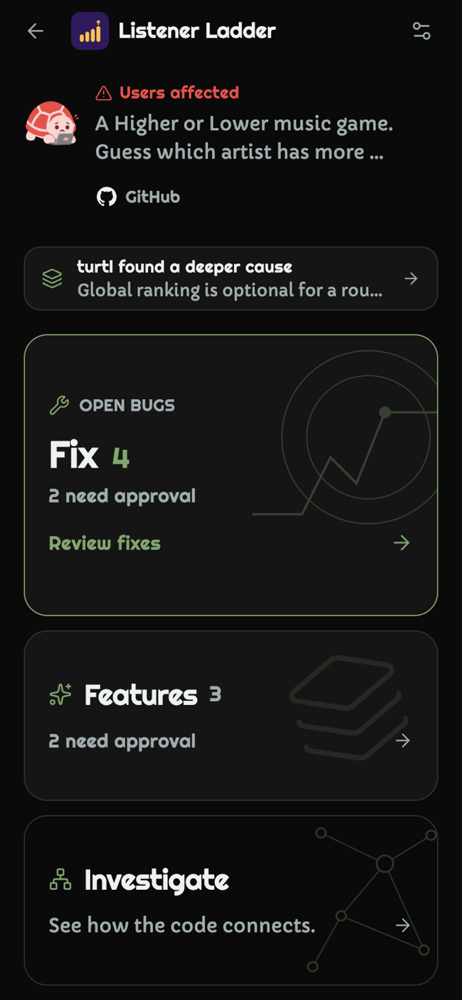
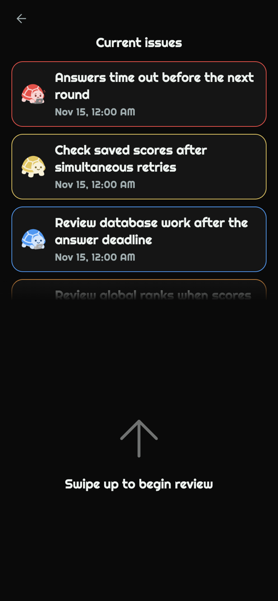
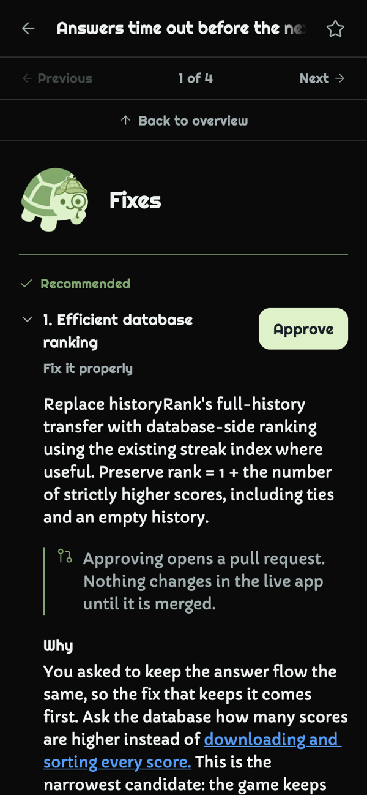
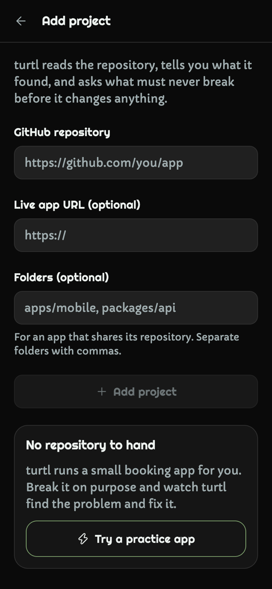
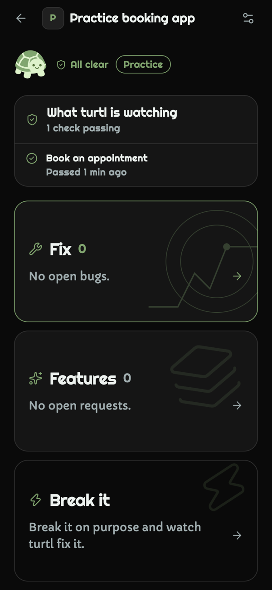
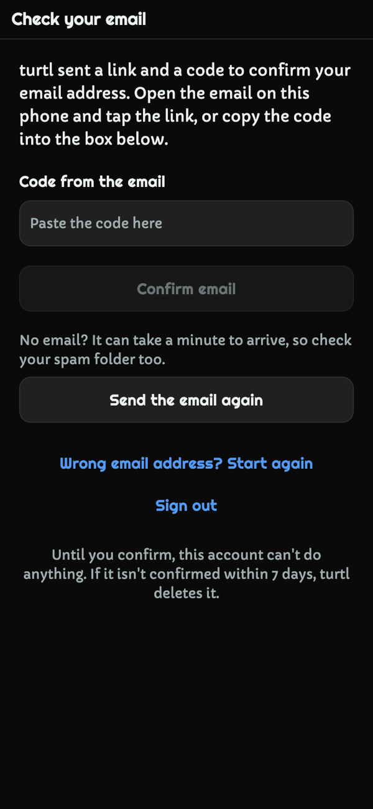
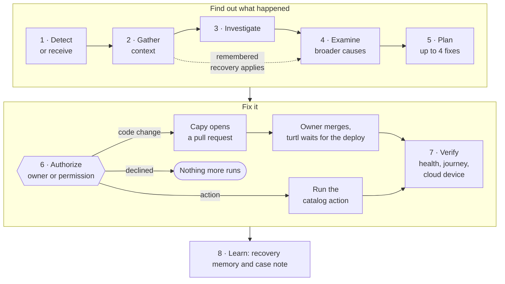

<p align="center">
  
</p>

<p align="center"><b>The on-call app for people who own a live app and have no operations team.</b></p>

<p align="center">
  
  
  
  
</p>

<p align="center">
  
  
  
  
</p>
<p align="center">
  
  
  
</p>
<p align="center"><sub>Login → Projects → a project → its issues → an opened issue → its fixes → the plan of an approved fix.</sub></p>
<p align="center">
  
  
  
</p>
<p align="center"><sub>Try a practice app → the practice project → Check your email, which a new password account sees until it confirms its address. All captured from an Expo web build of <code>build/wave-3</code> (9c2d407) on its built-in example data, at 390 × 844. The first-run screen, which also offers Try a practice app, shows only for an account with no projects, which the example data does not have.</sub></p>

turtl tracks each case (an outage, a bug report or a feature request) as a series of steps, from detecting a problem to learning from it. It watches the journeys you register, takes in what your customers report, works out what went wrong, explains it in plain words, and offers you one to four fixes. Nothing changes in your live app until you approve, or until a narrow permission you granted covers it. `turtl` is the working name; the build log is in [hackathon.md](hackathon.md).

## Two ways to run the backend

The same code runs in two modes, chosen by one deployment variable, `AUTH_REQUIRED`:

| | Single-owner demo (`AUTH_REQUIRED` unset, empty or `false`) | Accounts (any other value; production uses `true`) |
| --- | --- | --- |
| Who signs in | Nobody, and the demo makes no accounts. The Login buttons open Projects, and every project belongs to one owner | Email and password, Sign in with Apple, or GitHub ([`convex/auth/`](convex/auth/README.md)). A password account confirms its email address with an emailed code before it reaches anything, and one never confirmed is deleted after 7 days. Every project belongs to an account, and [`convex/access.ts`](convex/access.ts) decides in one place who may read or change what |
| Owner decisions | Protected by a shared owner passcode, once set | Made by the signed-in owner of the project |
| AI services | Called whenever their keys are set, including the council's Anthropic and Google models | Nothing is sent to OpenAI, Supermemory or Capy until the owner allows it on one screen that names each service and what it receives ([`convex/consent/`](convex/consent/README.md)); Anthropic, Google and Keiki are never asked about and never reached. Each account has a monthly model allowance, daily shares of the deployment's AI ceiling ($2.50 for its own calls, $1.00 for its customers' reports, by default), and a daily number of code changes ([`convex/spend/`](convex/spend/README.md)). When turtl does not use AI it says why on the case and explains with its own rules |
| Repositories | The deployment's `GITHUB_TOKEN`, or the GitHub App when one is configured | The owner connects GitHub in the app through turtl's GitHub App, and can disconnect; `GITHUB_TOKEN` is ignored ([`convex/github/`](convex/github/README.md)). Only repositories the person can push to are linked, and turtl asks GitHub again before a merge or coding-agent work. A member who can only read a repository cannot connect it; disconnecting never uninstalls turtl from an organization |
| The watched app and the coding agent | One `PROTECTED_APP_URL` and control secret, and the deployment's `CAPY_API_KEY` | Each project's own address (https, a public name, the standard port) and control token, and each account's own Capy key, sealed at rest under `SECRETS_ENCRYPTION_KEY` ([`convex/secrets/`](convex/secrets/README.md)). The monitor checks each project that has checks on its own schedule, about once a minute, and less often, at least every 15 minutes, while it keeps failing the same way |
| Practice | None | Each account can make one practice project: a small booking app the backend serves itself under `/practice/<project id>/`, which the owner breaks on purpose (up to 10 times a day) and turtl fixes ([`convex/practice/`](convex/practice)) |
| Alerts | A Keiki text to one phone number set on the deployment | A push to the owner's own phones through Expo's push service, only while the session that turned notifications on is alive ([`convex/push/`](convex/push/README.md)) |
| Deleting | Nothing to delete | The owner deletes their account in the app: its projects and data, its copies at Supermemory, its GitHub link and its Apple token go ([`convex/account/`](convex/account/README.md)) |
| Dev tools | Available with `DEV_TOOLS_ENABLED=true` | Closed, whatever the variable says |

Any value of `AUTH_REQUIRED` but unset, empty or `false` turns accounts on. The demo makes no accounts, and a deployment that holds any account refuses to run as the demo: every call answers "turtl is unavailable right now" and the backend log says `AUTH_REQUIRED` is missing on a deployment with accounts. A store build (`EXPO_PUBLIC_APP_ENV` set to `preview` or `production`) refuses a backend without accounts. See [`release/README.md`](release/README.md).

## How a case moves

Every case gets the same eight steps, defined once in [`convex/constants.ts`](convex/constants.ts) and run on the Convex scheduler by [`convex/runner/`](convex/runner/README.md), with no phone connected.



| Step | What it does |
| --- | --- |
| 1. Detect or receive | A cron checks registered journeys and opens one outage case when a check runs and fails; with accounts on it checks each project that has checks on its own schedule, about once a minute and less often while it keeps failing the same way, each with its own address and token. An app that does not answer at all records a check error on the project, but opens no case and sends no notification. Customer reports arrive at `POST /intake/report`, are triaged, and land on one bug report or feature request per problem. The step records what it saw before any change. |
| 2. Gather context | For a new journey case, two read-only branches collect the app's state and its error window, joined by one step that keeps their exact provenance. It reads the app fresh (journey check, health, errors, flags, revision) and recalls recovery memory. When every condition of a remembered recovery holds, investigation is skipped. |
| 3. Investigate | A deterministic selector sends the case to a quick look or a careful review; an unfamiliar case still unsure after that goes to a council of models whose view says that agreement is not proof. Up to three earlier case notes are background. When no model answers, a rule-based reading that says so. |
| 4. Examine broader causes | When the case has related history on the same app, one model call asks whether a deeper cause is at work; a finding needs evidence from at least two cases and joins the fixes as a code change that is never recommended. Otherwise the step records why it did not look. |
| 5. Plan | At most four fixes. For an outage, the app's catalog action plus up to three code changes a model proposes; for a customer case, one to four code changes. Each says what changes, what might be lost and how turtl checks it. The owner's stated preferences can reorder them; they never satisfy a condition or a permission. |
| 6. Authorize and execute | Waits for the owner, unless a scoped permission covers the case. Approving shows exactly what will be sent, freezes the chosen fix and runs it once: an action goes to the app over HTTP, and a code change goes to a Capy coding agent, word for word as approved, which opens a pull request. The owner merges it from turtl, and the step waits until the app reports the merged revision as deployed. Declining skips every remaining step. |
| 7. Verify | Checks health, the changed flag (for an action) and the journey again, then the app on a Revyl cloud device when a Revyl check is configured. A failing journey fails the step, and a criterion no check covers reads "Not covered". |
| 8. Learn | Saves a recovery memory from a verified recovery and writes a case note that later diagnoses read. |

A case's status follows its steps: `open`, `investigating`, `waiting_for_owner`, `executing`, `waiting_for_deploy` for a pull request, `verifying`, then `restored` (service is back) or `resolved` (the permanent repair is finished). A step that fails three attempts ends the case `unresolved`; a decline ends it `declined`.

## What it can do now

**In the app**

- **Login** offers Log in, Apple, GitHub and Sign up, with the privacy policy, terms and support links. With accounts on (or in a store build) they sign in for real; in the demo they open Projects. After a password sign-up the app shows **Check your email** until the code turtl emailed is entered: tap the `turtl://` link in the email, or paste the code. Gmail is known to drop `turtl://` links, so its users paste the code; and another app on the phone that claims `turtl://` could receive a link's code, which only universal links on a domain the operator controls would prevent.
- **Projects** puts the projects that need you first and shows each one's health as a turtle, its open bugs and feature requests, and how many fixes wait for approval. An account with no projects sees a first-run screen with **Add your first project** and **Try a practice app**; **Add project** takes a GitHub repository (with Connect GitHub when the backend has the GitHub App) and, optionally, the live app's address, then reads the repository and reports what turtl can watch.
- **A project** opens to Fix, Features (customer requests, with how many people asked) and Investigate (a map of the project's code you can ask questions about). A project with nothing open shows what turtl is watching and when each check last passed.
- **A practice project** carries a Practice chip, and in place of Investigate offers a way to break its app on purpose: a sheet says what will happen, turtl's ordinary watching opens a case, and the ordinary flow fixes it. It has no repository and never calls GitHub or a coding agent.
- **The issues list** shows compact rows (state turtle, title, date); swiping up begins the review of the first one.
- **An opened issue** is headed by its own name and has Overview, Logs and Code tabs. Claims link inline to the evidence they rest on, and the Overview shows screenshots from the app. **Fixes** is its own page, reached by swiping past the end of the issue or with "Look at potential fixes", recommended first.
- **Approving** always goes through one confirmation that shows the full instructions a coding agent will receive. The fix then gets its own screen with the pull request, its checks, Stop, Merge and the plan step by step with timings.
- **Investigate further** is a chat about the case that answers from what turtl recorded and can add another fix. **Talk** asks the same chat out loud; a spoken "approve" or "merge" is answered with where the button is and never acts.
- **Settings** (the gear on a project): who approves that project's fixes (You, or Auto under a scoped permission), Dark or Light, and the owner's preferences. On a live backend it also shows the rows that apply there: the project's customer report keys and GitHub; with accounts on, the project's control token, notifications, the AI permission, the coding agent, and Sign out and Delete account (also in the account sheet behind Home's profile picture); in the demo, the owner passcode.
- **Example data** with four projects runs every project screen without a backend, and opens no backend connection. Add project offers the practice app there too; it lives in memory and nothing leaves the device.
- **Type:** short labels, titles, names and counts are set in Righteous and full sentences in Capriola; the text component decides from the words it draws ([`components/ui/typeface.ts`](components/ui/typeface.ts)).

**On the backend**

- **Case runner**: eight steps on the Convex scheduler, with retries (three attempts), time limits, late results kept without overwriting newer ones, and scheduled jobs cancelled by id.
- **Customer intake**: a rate-limited public endpoint takes the words customers type in your app, from a report form any owner can copy ([`protected-app/report/`](protected-app/report/README.md)). A model (or labelled rules) triages each report as a bug, a request or noise and merges duplicates into one case. Customer text is treated as evidence, never as instructions; a contact is kept only as a hash (keyed with `INTAKE_CONTACT_KEY` when it is set), and an owner can delete one report.
- **Fixes bound to a catalog**: every option is an entry in the app's action catalog. A model writes the words and the change request, never the target, the catalog entry or a parameter outside the entry's constraints.
- **Pull requests through Capy and GitHub**: an approved code change starts a Capy thread that opens one pull request. turtl follows it and merges only when checks pass and its head is still the commit the owner saw.
- **Verification on a device**: health, journey and a Revyl cloud-device run, with its screenshots kept.
- **Recovery memory** in Convex, indexed in Supermemory: recall only proposes, and the remembered fix still needs approval and fresh verification.
- **Scoped permission**: after two verified recoveries, the owner can let turtl run one pinned action on its own, bound to the app's revision, at most three times. A run that does not restore service revokes it.
- **Onboarding**: reads a connected repository, judges what turtl can watch, and, once the owner approves, asks the coding agent for a pull request that adds a `turtl.json` manifest and tests.
- **Code network**: maps a GitHub repository into parts and groups, keeps the code in Supermemory with secrets masked first, and answers questions about the whole map, a group or one part.
- **Voice turns**: OpenAI speech to text and text to speech; audio is never stored.
- **Accounts mode** as in the table above: confirmed sign-up, the access rule (every public function is made with the builders in [`convex/functions.ts`](convex/functions.ts), which check it), the AI permission and spend limits, the GitHub App, push, sealed secrets, the practice project, and account deletion.
- **A demo app to protect**: a booking backend on the same deployment ([`convex/bookingDemo/`](convex/bookingDemo/README.md)) and its customer app ([`protected-app/`](protected-app/README.md)), with staged failures turtl can detect and recover from.

## Quick start

You need Node and npm. The example data needs no backend and no keys:

```sh
git clone https://github.com/ronoktanvir/turtl.git && cd turtl
npm install
npx expo start --web
```

`npx expo start` opens the same app on iOS or Android. Without a backend the Login buttons open Projects.

To run on your own Convex backend:

```sh
npx convex dev    # in one terminal: syncs convex/ and writes .env.local
npx expo start    # in another terminal
```

The app reads the backend address from `EXPO_PUBLIC_CONVEX_URL`. `npx convex dev` writes it to `.env.local`, which Git ignores; [`.env.example`](.env.example) shows the shape. Without it, the project screens use the example data. To see the example data with a backend configured, start with `EXPO_PUBLIC_DATA_SOURCE=example`.

A new deployment is the single-owner demo. To protect the booking demo end to end, set the watched-app variables, register it with `npx convex run dev:registerBooking '{}'`, and follow [`convex/bookingDemo/README.md`](convex/bookingDemo/README.md). To run with accounts, make the sign-in keys and set `AUTH_REQUIRED=true` as [`convex/auth/README.md`](convex/auth/README.md) describes; password sign-up also needs `AUTH_RESEND_KEY` and `AUTH_EMAIL_FROM`, since it waits for an emailed code. A deployment that has held accounts cannot go back to being the demo until its `authAccounts` table is empty.

## The web demo

The screens also run in a browser, from Expo's web export. [`vercel.json`](vercel.json) tells Vercel how to build it: `npm ci`, then `npx expo export --platform web` into `dist/`, with every path answered by the single page. With no backend address in the build's environment, it shows the built-in example data and opens no backend connection, so a deployment made from the repository alone is a safe demo that calls no backend.

## Configuration

Set app variables in `.env.local` or the build environment. Set deployment variables with `npx convex env set NAME value`; values are never committed. None is needed for the example data.

| App variable | Purpose |
| --- | --- |
| `EXPO_PUBLIC_CONVEX_URL` | The Convex deployment the app talks to. |
| `EXPO_PUBLIC_DATA_SOURCE` | `example` keeps the project screens on example data even with a backend address (not in a store build). |
| `EXPO_PUBLIC_APP_ENV` | `development`, `preview` or `production`; set by each EAS build profile. Leave it empty for local work and the demo. |
| `EXPO_PUBLIC_DEV_TOOLS` | `1` shows the dev tools in a non-development build of the demo; the deployment also needs `DEV_TOOLS_ENABLED`. |
| `TURTL_PREVIEW_ORIGIN` | Build time only: passed to Expo Router as its origin (`extra.router.origin`). |

Every variable the backend reads, whether production needs it, and what it does, is in the table in [`release/backend-runbook.md`](release/backend-runbook.md), generated from [`release/backend-env.mjs`](release/backend-env.mjs). A backend feature whose variable is missing says so and sends nothing, or falls back where it can, such as the labelled rule-based diagnosis.

The booking app in [`protected-app/`](protected-app/README.md) reads `EXPO_PUBLIC_CONVEX_URL`, `EXPO_PUBLIC_TURTL_INTAKE_KEY` (its public report key) and, optionally, `EXPO_PUBLIC_TURTL_INTAKE_URL`.

## Project structure

| Folder | What is in it |
| --- | --- |
| [`app/`](app) | Screens (Expo Router): login, sign-in, sign-up, confirm-email, reset-password, projects, add-project, ai-permission, `project/`, `review/`, and the older live feed (`live`, `case/`), which a store build sends to Projects |
| [`components/`](components) | UI: `ui/` (shared parts and the text component), `fix/`, `execution/` (the plan), `network/` (code map), `voice/`, `project/`, `practice/`, `account/`, `consent/`, `push/`, `github/`, `secrets/`, `reportKeys/`, `onboarding/`, `legal/`, `feed/`, `dev/` |
| [`data/`](data) | What the screens read: `example/` (built-in examples) or `live/` (Convex), chosen in `source.ts`, plus the account, consent, push, GitHub, secrets and practice hooks |
| [`theme/`](theme) | Colors, type and design tokens |
| [`convex/`](convex) | Backend: schema, constants, workflow, `access.ts`, `runner/`, monitor, decisions, permissions, `auth/`, `consent/`, `spend/`, `github/`, `push/`, `secrets/`, `account/`, `memory/`, `intake/`, `prTracking/`, `revyl/`, `voice/`, `codeNetwork/`, `onboarding/`, `routing/`, `council/`, `structural/`, `learning/`, `practice/`, Keiki alerts (demo only), `bookingDemo/` |
| [`protected-app/`](protected-app) | The customer booking app turtl protects in the demo, with its own package, and the report form owners can copy |
| [`tests/`](tests/README.md) | `node:test` suites |
| [`release/`](release/README.md) | Build profiles' rules, release checks and the production backend runbook |
| [`store/`](store/README.md) | What App Review reads apart from the build: the data audit, App Privacy answers, the checklist and the review notes |
| [`site/`](site/README.md) | The privacy policy, terms and support pages, published with GitHub Pages |
| [`docs/`](docs) | Reference and the screenshots above |

`convex/_generated/` is committed; regenerate it with `npx convex dev` when you change the schema or functions.

## Checks

```sh
npm run typecheck                         # the app and convex/
npm --prefix protected-app run typecheck  # the booking app, against its own dependencies
npm run test:ci                           # every test that needs no browser, as CI runs it
node store/check.mjs                      # the App Store pack against the code
node release/preflight.mjs --advisory     # release readiness, as warnings
```

The two browser tests need the example UI running, so start it in one terminal and run every suite in another:

```sh
EXPO_PUBLIC_DATA_SOURCE=example npx expo start --web --port 8081
npm run test:ui
```

They open that UI in Chromium at a phone-size viewport; set `CHROME_PATH` when Chrome is not at a standard path and `UI_BASE_URL` for another preview. The backend suites run the real modules against an in-memory database, with accounts on and off, and against stand-ins for every vendor; some proofs run on a local Convex backend. See [`tests/README.md`](tests/README.md). Each pull request also gets both typechecks and `npm run test:ci` in GitHub Actions, and an iOS simulator build and a proof-of-changes run on a cloud iPhone from [`.revyl/config.yaml`](.revyl/config.yaml).

## Reference

- [Data model and workflow rules](docs/data-model.md)
- [Dev tools](docs/dev-tools.md)
- [Supermemory](docs/assistant-memory.md)
- [Owner alerts](docs/owner-alerts.md)
- [The runner and its handler contract](convex/runner/README.md), [customer reports](convex/intake/README.md), [recovery memory](convex/memory/README.md), [voice](convex/voice/README.md)
- [Sign-in](convex/auth/README.md), [the AI permission](convex/consent/README.md), [spend limits](convex/spend/README.md), [the GitHub App](convex/github/README.md), [push](convex/push/README.md), [secrets](convex/secrets/README.md), [account deletion](convex/account/README.md)
- [The booking demo backend](convex/bookingDemo/README.md) and [its customer app](protected-app/README.md)
- [Releasing for iOS](release/README.md) and [what App Review reads](store/README.md)
- [Build log](hackathon.md)
