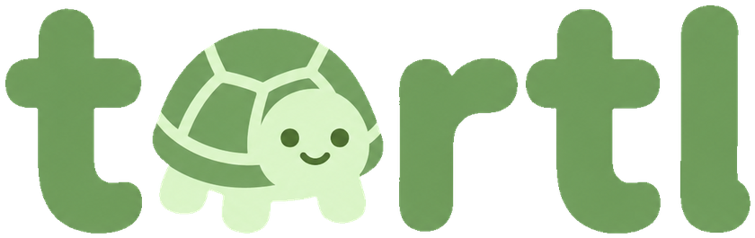
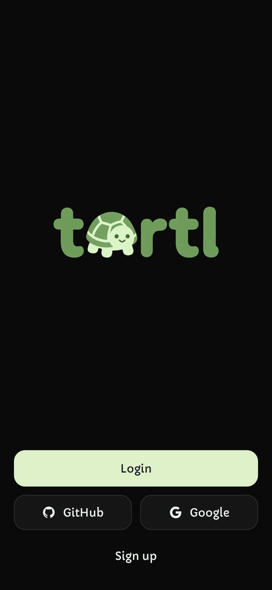
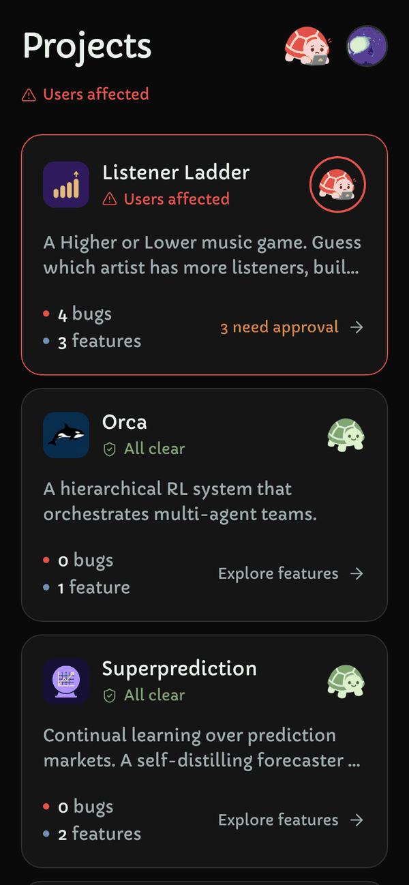
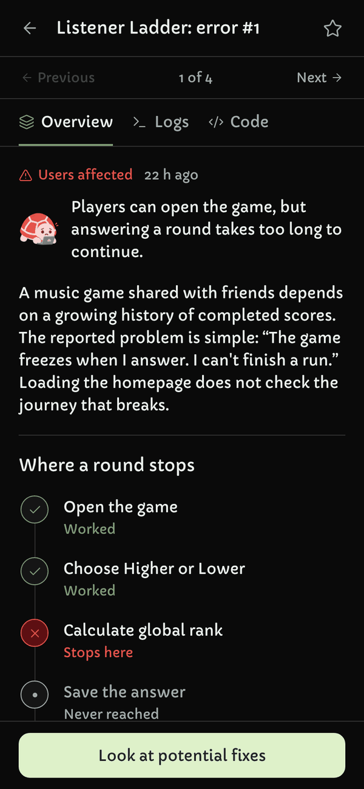
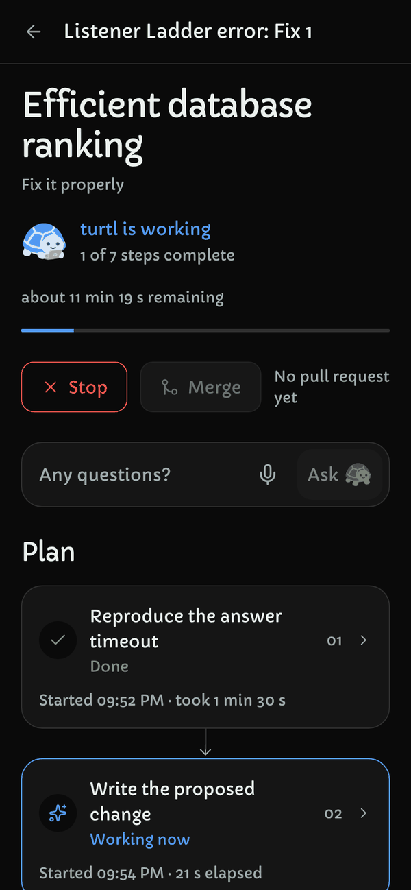
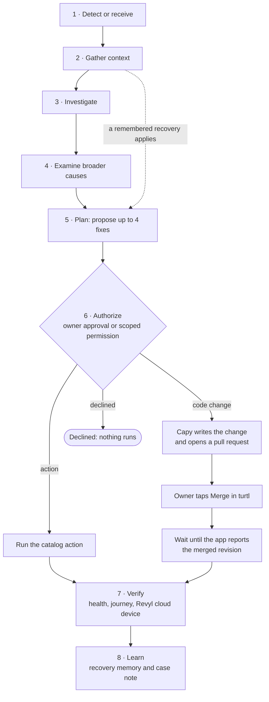

<p align="center">
  
</p>

<p align="center"><b>The on-call app for people who own a live app and have no operations team.</b></p>

<p align="center">
  
  
  
  
</p>

<p align="center">
  
  
  
  
  
</p>
<p align="center"><sub>Login → Projects → a project → a case → the plan of an approved fix. Captured from an Expo web build of <code>main</code> on its built-in example data.</sub></p>

turtl tracks each case (an outage, a bug report or a feature request) as a series of steps, from detecting a problem to learning from it. It watches the journeys you register, takes in what your customers report, works out what went wrong, and offers you one to four fixes. Nothing changes in your live app until you approve, or until a narrow permission you granted covers it. `turtl` is the working name; the build log is in [hackathon.md](hackathon.md).

## How a case moves

Every case gets the same eight steps, defined once in [`convex/constants.ts`](convex/constants.ts) and run on the Convex scheduler by [`convex/runner/`](convex/runner/README.md), with no phone connected.



| Step | What it does on `main` |
| --- | --- |
| 1. Detect or receive | A cron checks every registered journey once a minute and opens one outage case per failure. Customer reports arrive at `POST /intake/report`, are triaged, and land on one bug report or feature request per problem. The step records what it saw before any change. |
| 2. Gather context | Reads the app fresh (journey check, health, errors, flags, revision) and recalls recovery memory. When every condition of a remembered recovery holds, steps 3 and 4 are skipped. |
| 3. Investigate | One model call over the facts, with up to three earlier case notes as background. When no model answers, a rule-based reading that says so. |
| 4. Examine broader causes | A placeholder on `main`: it records that no broader causes were examined. |
| 5. Plan | At most four fixes. For an outage, the app's catalog action (for the booking demo, turning recommendations off) plus up to three code changes a model proposes; for a customer case, one to four code changes. Each says what changes, what might be lost and how turtl checks it. |
| 6. Authorize and execute | Waits for the owner, unless a scoped permission covers the case. Approval freezes the chosen fix and runs it once: an action goes to the app over HTTP, and a code change goes to a Capy coding agent that opens a pull request. The owner merges it from turtl, and the step waits until the app reports the merged revision as deployed. Declining skips every remaining step. |
| 7. Verify | Checks health, the changed flag (for an action) and the journey again, then the booking screen on a Revyl cloud device when Revyl is configured. A failing journey fails the step, and a criterion no check covers reads "Not covered". |
| 8. Learn | Saves a recovery memory from a verified recovery and writes a case note that later diagnoses read. |

A case's status follows its steps: `open`, `investigating`, `waiting_for_owner`, `executing`, `waiting_for_deploy` for a pull request, `verifying`, then `restored` (service is back) or `resolved` (the permanent repair is finished). A step that fails three attempts ends the case `unresolved`; a decline ends it `declined`.

## What's on `main`

**In the app**

- **Projects** puts the projects that need you first and shows each one's health as a turtle, its open bugs and feature requests, and how many fixes wait for approval.
- **A project** opens to Fix (current issues), Features (customer requests, with how many people asked) and Investigate (a map of the project's code you can ask questions about).
- **A case** has Overview, Logs and Code tabs. Claims link inline to the evidence they rest on, the Overview shows screenshots from the app, and the fixes follow, recommended first.
- **Approving** always goes through a confirmation. The fix then gets its own screen with the pull request, its checks, Stop, Merge and the plan step by step with timings.
- **Investigate further** is a chat about the case that answers from what turtl recorded and can add another fix. **Talk** asks the same chat out loud, hands-free; a spoken "approve" or "merge" is answered with where the button is and never acts.
- **Settings** (the gear on a project): who approves that project's fixes (You, or Auto under a scoped permission), Dark or Light, and, on a backend, the owner passcode.
- **Example data** with four projects runs every project screen without a backend.

**On the backend**

- **Case runner**: eight steps on the Convex scheduler, with retries (three attempts), time limits, and late results kept without overwriting newer ones.
- **Customer intake**: a rate-limited public endpoint takes the words customers type in your app. A model (or labelled rules) triages each report as a bug, a request or noise and merges duplicates into one case with message and people counts. Customer text is treated as evidence, never as instructions.
- **Fixes bound to a catalog**: every option is an entry in the app's action catalog. A model writes the words and the change request, never the target, the catalog entry or a parameter outside the entry's constraints.
- **Pull requests through Capy and GitHub**: an approved code change starts a Capy thread that opens one pull request. turtl follows it every 30 seconds and merges only when checks pass and its head is still the commit the owner saw.
- **Verification on a device**: health, journey and a Revyl cloud-device run of the booking screen, with its screenshots kept.
- **Recovery memory** in Convex, indexed in Supermemory: recall only proposes, and the remembered fix still needs approval and fresh verification.
- **Scoped permission**: after two verified recoveries, the owner can let turtl run one pinned action on its own, bound to the app's revision, at most three times. A run that does not restore service revokes it.
- **Owner passcode**: once set, decisions, merges and permission changes need it, and linking or merging a pull request is refused until one is set. Only its hash is stored on the backend; the device keeps the passcode.
- **Owner alerts through Keiki** when a case opens, needs a decision, or was handled under a permission, with one recorded outcome per case and event.
- **Code network**: maps a GitHub repository into parts and clusters, keeps the code in Supermemory, and answers questions about the whole map, a cluster or one part.
- **Voice turns**: OpenAI speech to text and text to speech; audio is never stored.
- **A demo app to protect**: a booking backend on the same deployment ([`convex/bookingDemo/`](convex/bookingDemo/README.md)) and its customer app ([`protected-app/`](protected-app/README.md)), with staged failures turtl can detect and recover from.

## Quick start

You need Node and npm. The example data needs no backend and no keys:

```sh
git clone https://github.com/ronoktanvir/turtl.git && cd turtl
npm install
npx expo start --web
```

`npx expo start` opens the same app on iOS or Android. Login, GitHub, Google and Sign up are demonstration controls that open Projects; there is no sign-in yet.

To run on your own Convex backend:

```sh
npx convex dev    # in one terminal: syncs convex/ and writes .env.local
npx expo start    # in another terminal
```

The app reads the backend URL from `EXPO_PUBLIC_CONVEX_URL`. `npx convex dev` writes it to `.env.local`, which Git ignores; [`.env.example`](.env.example) shows the shape. Without it, the project screens use the example data, and the older live feed (`/live`, `/case/<id>`) shows a screen saying the backend URL is not configured. To see the example data with a backend configured, start with `EXPO_PUBLIC_DATA_SOURCE=example`.

To protect the booking demo end to end, set the variables below on the deployment, register it with `npx convex run dev:registerBooking '{}'`, and follow [`convex/bookingDemo/README.md`](convex/bookingDemo/README.md).

## Configuration

Set app variables in `.env.local` or the build environment. Set deployment variables with `npx convex env set NAME value`; values are never committed. None is needed for the example data. A backend feature whose variable is missing says so and sends nothing, or falls back where it can, such as the labelled rule-based diagnosis.

| Variable | Purpose |
| --- | --- |
| **App (Expo)** | |
| `EXPO_PUBLIC_CONVEX_URL` | The Convex deployment the app talks to. |
| `EXPO_PUBLIC_DATA_SOURCE` | `example` keeps the project screens on example data even with a backend URL. |
| `EXPO_PUBLIC_DEV_TOOLS` | `1` shows the dev tools in a release build; the deployment also needs `DEV_TOOLS_ENABLED`. |
| `TURTL_PREVIEW_ORIGIN` | Build time only: passed to Expo Router as its origin (`extra.router.origin`). |
| **App to protect** | |
| `PROTECTED_APP_URL` | Base URL of the protected app's control routes; the journey monitor does nothing without it. |
| `PROTECTED_APP_CONTROL_SECRET` | Bearer token turtl sends to those routes. |
| `PROTECTED_APP_CONTROL_SECRET_SHA256` | Booking demo: the token's SHA-256, which its control routes check. |
| `PROTECTED_APP_REVISION` | Booking demo: the revision it reports. |
| **Models (OpenAI)** | |
| `OPENAI_API_KEY` | Diagnosis, fixes, case chat, customer triage, voice, the code network and the assistant action. |
| `DIAGNOSIS_MODEL` | Model for Investigate; default `gpt-5.4-mini`. |
| `FIXES_MODEL` | Model for fixes, case chat and customer reports; defaults to the diagnosis model. |
| `OPENAI_MODEL` | Model for the code network and the assistant action; default `gpt-6-luna`. |
| **Code changes** | |
| `CAPY_API_KEY` | Lets an approved code change start a Capy thread that opens the pull request. |
| `CAPY_PROJECT_ID` | Optional Capy project; without it, the project that holds the repository. |
| `CAPY_MODEL_ID`, `CAPY_REASONING` | Optional model and reasoning mode for that thread. |
| `GITHUB_TOKEN` | Follows and merges the case's pull request; reads private repositories for the code network. |
| **Device checks (Revyl)** | |
| `REVYL_API_KEY` | Runs the booking journey on a Revyl cloud device during Verify. |
| `REVYL_BOOKING_WORKFLOW_ID` | The Revyl workflow that run uses. |
| `REVYL_BASE_URL` | Optional; default `https://backend.revyl.ai`. |
| **Memory (Supermemory)** | |
| `SUPERMEMORY_API_KEY` | Indexes recovery memories, case notes, customer reports and code; the assistant action needs it. |
| `INTAKE_NAMESPACE_PREFIX` | Optional prefix that keeps a test deployment's report namespaces apart. |
| **Voice** | |
| `VOICE_ENABLED` | `true` turns on talking with turtl about a case. |
| `VOICE_TRANSCRIBE_MODEL` | Default `gpt-4o-mini-transcribe`. |
| `VOICE_SPEECH_MODEL` | Default `gpt-4o-mini-tts`. |
| **Code network** | |
| `CODE_NETWORK_CHAT_ENABLED` | `true` allows questions about the code map. |
| **Owner alerts (Keiki)** | |
| `KEIKI_API_KEY`, `KEIKI_AGENT_ID`, `KEIKI_OWNER_CONTACT` | All three are needed to message the owner. |
| `KEIKI_BASE_URL` | Optional; default `https://onkeiki.com`. |
| **Assistant action** | |
| `ASSISTANT_ENABLED` | `true` lets `api.assistant.chat` run. |
| **Development** | |
| `DEV_TOOLS_ENABLED` | `true` enables the dev tools and every dev-only function. |

The booking app in [`protected-app/`](protected-app/README.md) reads `EXPO_PUBLIC_CONVEX_URL`, `EXPO_PUBLIC_TURTL_INTAKE_KEY` (its public report key) and, optionally, `EXPO_PUBLIC_TURTL_INTAKE_URL`.

## Project structure

```text
app/              Screens (Expo Router): login, projects, project/, review/, and the older live feed (live, case/)
components/       UI: ui/ (shared parts), fix/, execution/ (the plan), network/ (code map), voice/, project/, feed/, dev/
data/             What the screens read: example/ (built-in examples) or live/ (Convex), chosen in source.ts
theme/            Colors, type and design tokens
convex/           Backend: schema, constants, workflow, runner/, monitor, decisions, permissions, memory/, intake/,
                  prTracking/, revyl/, voice/, codeNetwork/, keiki and notices, bookingDemo/
protected-app/    The customer booking app turtl protects in the demo, with its own package
tests/            node:test suites
docs/             Reference and the screenshots above
```

`convex/_generated/` is committed; regenerate it with `npx convex dev` when you change the schema or functions.

## Tests

```sh
npm run typecheck                         # tsc for the app and convex/
npm --prefix protected-app run typecheck  # the booking app checks against its own dependencies

EXPO_PUBLIC_DATA_SOURCE=example npx expo start --web --port 8081   # one terminal
npm run test:ui                                                     # another: node --test tests/*.test.mjs
```

The browser tests open the example UI in Chromium at a phone-size viewport; set `CHROME_PATH` when Chrome is not at a standard path and `UI_BASE_URL` for another preview. The rest run without a server. See [`tests/README.md`](tests/README.md). Backend checks that need a deployment are `memory/dev:prove` ([`convex/memory/README.md`](convex/memory/README.md)) and the booking control check ([`convex/bookingDemo/README.md`](convex/bookingDemo/README.md)). Each pull request also gets an iOS simulator build and a proof-of-changes run on a cloud iPhone from [`.revyl/config.yaml`](.revyl/config.yaml).

## Reference

- [Data model and workflow rules](docs/data-model.md)
- [Dev tools](docs/dev-tools.md)
- [Assistant action and Supermemory](docs/assistant-memory.md)
- [Owner alerts](docs/owner-alerts.md)
- [The runner and its handler contract](convex/runner/README.md), [customer reports](convex/intake/README.md), [recovery memory](convex/memory/README.md), [voice](convex/voice/README.md)
- [Build log](hackathon.md)
