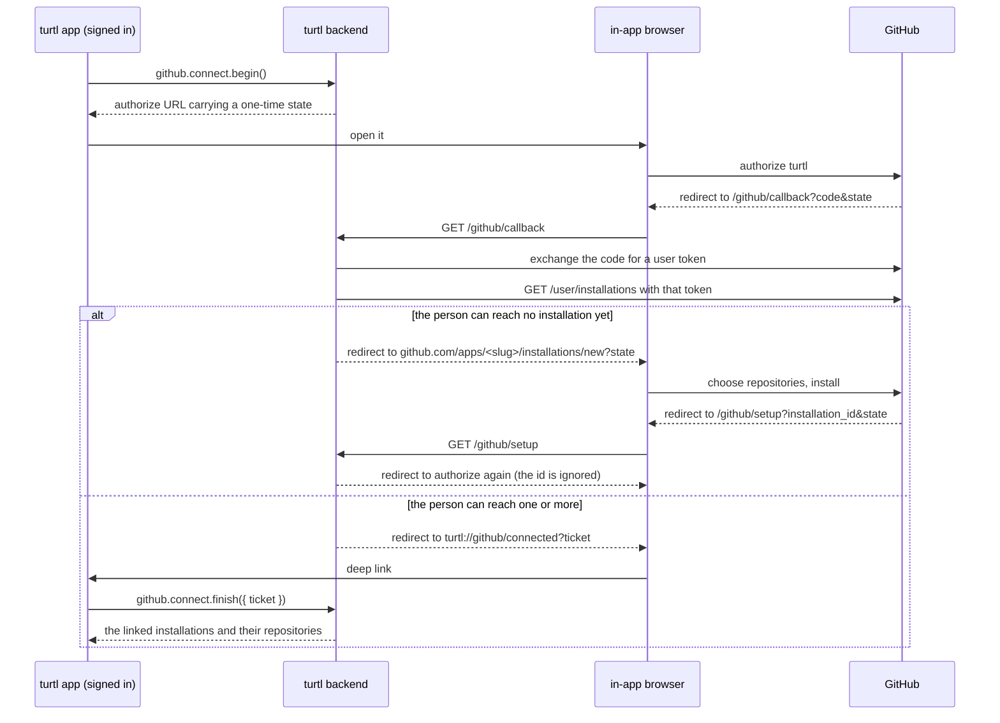

# GitHub App: linking a person's repositories

turtl used to reach GitHub with one token for the whole deployment (`GITHUB_TOKEN`), so one person's turtl could read one person's code. This module lets each GitHub account grant turtl access to the repositories it chooses, through a GitHub App, and take that access back by uninstalling it.

**What exists now (first pull request):** the app's definition, installation tokens, the webhook receiver, the one function that picks the credential for a repository, and the repository listing. All of it is backend, and all of it is proven against a stand-in for GitHub (`scripts/github-app/stub.mjs`). **Nothing has run against real GitHub**, because the app does not exist yet: only Ronok can create it. The checks to run once it exists are [below](#checks-to-run-once-the-app-exists).

**What comes next (second pull request):** the Connect GitHub flow that ties an installation to a signed-in turtl account, and its screens. It is [designed below](#second-pull-request-connect-github) and not built.

## Files

- `app-manifest.json`: the GitHub App's definition, in GitHub's manifest format, with `https://YOUR-DEPLOYMENT.convex.site` standing in for the deployment's HTTP address.
- `config.ts`: reads the variables and decides whether the app is absent, incomplete or ready.
- `jwt.ts`: signs the app's JWT (RS256) with Web Crypto. Takes the key as GitHub hands it out (PKCS#1) or as PKCS#8.
- `api.ts`: the five GitHub calls the module makes.
- `tokens.ts`: the installation token cache. The only file that touches `githubInstallationTokens`.
- `access.ts`: `repositoryAccess(ctx, "owner/name")`, the one place that decides which credential reaches a repository, and `check`, which reports what is configured.
- `webhook.ts`: signature check and payload reading, with no Convex imports.
- `http.ts`: `POST /github/webhook` and a plain `GET /github/setup` page, registered from `convex/http.ts`.
- `installations.ts`: the records: applying a delivery, coverage, the repository list.
- `sync.ts`: `refresh`, which reads an installation's repositories from GitHub and makes the records match.
- `schema.ts`: four new tables, spread into `convex/schema.ts`.
- `scripts/github-app/link.mjs` prints the prefilled registration link; `stub.mjs` is the stand-in GitHub; `prove-local.mjs` runs the module on a local Convex backend. `tests/github-app.test.mjs` holds the tests.

Every function here is internal. Nothing in this module can be called from the app or from the public API.

## The app

| Setting | Value | Why |
| --- | --- | --- |
| Contents | Read and write | Reading code (`codeNetwork/build.ts`: a commit, the file tree, file contents) needs read. Merging a pull request (`PUT /pulls/{n}/merge`) needs write, and GitHub lists it under Contents. Reading one pull request is allowed by Contents too. |
| Checks | Read-only | `GET /commits/{sha}/check-runs`, shown on the pull request card and required to pass before a merge. |
| Commit statuses | Read-only | `GET /commits/{sha}/status`, the older kind of check. |
| Metadata | Read-only | GitHub requires it for every app. |
| Events | none subscribed | `installation` and `installation_repositories` reach every GitHub App without a subscription, and they are the only two turtl reads. |
| Webhook | `<site>/github/webhook` | Active, with a secret. |
| Callback URLs | `<site>/api/auth/callback/github`, then `<site>/github/callback` | The first is Sign in with GitHub (the accounts work, Convex Auth's path). The second is the Connect GitHub flow in the second pull request. |
| Setup URL | `<site>/github/setup`, also on update | Where GitHub sends a person after they install or change the app. |
| Request user authorization during installation | off | With it on GitHub drops the setup URL, and a change to an installation would send the person nowhere. The Connect flow asks for authorization itself. |
| Installable by | any account | A private app can only be installed on its owner's account. |

turtl never opens a pull request with this app: Capy opens it, through Capy's own GitHub connection. So Pull requests is not requested at all. Workflows is not requested either, which means GitHub will refuse a merge from turtl for a pull request that changes a file under `.github/workflows/`; the owner merges that one on GitHub.

## Which credential reaches a repository

`repositoryAccess(ctx, repo)` in `access.ts` decides, and `convex/pullRequests.ts` and `convex/codeNetwork/build.ts` ask it.

1. **No GitHub App variable is set** (`GITHUB_APP_ID`, `GITHUB_APP_SLUG`, `GITHUB_APP_PRIVATE_KEY`, `GITHUB_APP_WEBHOOK_SECRET`): every repository gets the deployment's `GITHUB_TOKEN`, exactly as before. GitHub is not asked anything and no table is read. This is the hosted demo today.
2. **Any of them is set**: `GITHUB_TOKEN` is never used for a repository again. If the id or the key is missing or unreadable, access is refused with a message that names the variable.
3. **The app is ready**: the repository gets a token of the installation that covers it. If turtl's records show no active installation for it, turtl asks GitHub once (`GET /repos/{owner}/{repo}/installation`); GitHub's answer is recorded and wins. No installation means no access: "turtl's GitHub App is not installed on owner/name".

The records only route a repository to an installation. GitHub decides what an installation token can reach, so a stale record can cause a refused request and never a wider one.

**Until the second pull request, this has no idea of accounts.** With the app configured, any installation that covers a repository serves any project on the deployment that names it. That is right for one owner per deployment, which is all turtl has today, and wrong the moment two accounts share a deployment. The second pull request adds the account to this function before that can happen.

## Installation tokens

`installationToken` in `tokens.ts` returns the cached token while it has more than five minutes left, and otherwise signs the app's JWT, asks GitHub for a new token (`POST /app/installations/{id}/access_tokens`) and stores it with GitHub's expiry. GitHub issues them for one hour.

The JWT is RS256, issued 60 seconds in the past against clock drift, expires nine minutes ahead (GitHub allows ten), and names `GITHUB_APP_ID` as its issuer.

Tokens live in `githubInstallationTokens`, apart from the installation rows, so a function that returns installations cannot return a token by accident. Only `tokens.ts` names that table, every function in this folder is internal, and a test fails if either stops being true. A token is never logged, never passed to the scheduler (whose arguments are stored), and never part of `check`'s answer. Any change to an installation that arrives by webhook drops its cached token.

## The webhook

`POST <site>/github/webhook`.

- Without `GITHUB_APP_WEBHOOK_SECRET` every delivery gets 503.
- The signature (`X-Hub-Signature-256`, HMAC-SHA256 of the raw body) is checked before anything is read from the body, with a comparison that takes the same time wherever a forgery differs. A wrong, missing or malformed signature gets 401 and touches no table.
- A delivery is applied once. Its `X-GitHub-Delivery` id and a SHA-256 of its body are stored; either one seen again answers `duplicate` and changes nothing. The body digest matters because GitHub signs only the body, so a captured delivery could otherwise be sent again under a new id.
- `installation`: `created`, `new_permissions_accepted` and `unsuspend` make the installation active and record its repositories; `suspend` suspends it; `deleted` marks it deleted and removes its repositories. A deleted installation keeps its row and never becomes active again from a webhook, because GitHub never reuses an installation id.
- `installation_repositories`: `added` and `removed` change the repository rows. When the installation switches between all repositories and selected ones, GitHub does not say which repositories were lost, so turtl schedules `sync.refresh` to read them back. It does the same for a delivery that lists more than 2,000 repositories.
- `ping` answers `pong`. Any other signed event answers `ignored` and is stored nowhere.

Answers are JSON: `{ ok: true, outcome: "applied" | "duplicate" | "ignored" | "pong" }` or `{ ok: false, error: { code, message } }`.

## Listing

- `internal.github.installations.repositories({ installationId })` (query): the repositories turtl has recorded for an active installation, by name, as `{ fullName, private? }`. Empty for a suspended or deleted one.
- `internal.github.sync.refresh({ installationId })` (action): reads the installation and every page of its repositories from GitHub, makes the records match (adds, updates, drops what GitHub no longer lists), and returns the same list. The repository picker calls this first so it never shows a stale list.

## Creating the app

Only the owner of the GitHub account can do this. It takes about five minutes. You need the HTTP address of the Convex deployment the app will serve, which looks like `https://<name>.convex.site`. The addresses can be changed later in the app's settings, so the app can be created against one deployment and moved.

1. In the repository, print the link and open it in a browser signed in to GitHub as the account that should own the app:

   ```sh
   node scripts/github-app/link.mjs --site https://<name>.convex.site
   ```

   Add `--org <organization>` to create it under an organization.
2. GitHub's "Register new GitHub App" form opens with everything filled in. Change nothing except:
   - **Webhook secret**: GitHub cannot take this from a link. Run `openssl rand -hex 32`, paste the result into "Secret", and keep it for step 4.
   - **GitHub App name**: it is filled in as "turtl on-call". "turtl" alone is taken by a GitHub user. If GitHub says the name is taken, pick another; the slug in step 3 follows the name.
   - Check that "Where can this GitHub App be installed?" says **Any account**.

   Press **Create GitHub App**.
3. On the app's settings page:
   - Note the **App ID** (a number) and the **Client ID**.
   - Note the slug: the last part of the app's public link, `https://github.com/apps/<slug>`.
   - Press **Generate a new client secret** and copy it now; GitHub shows it once.
   - Under "Private keys" press **Generate a private key**. A `.pem` file downloads.
4. Set the values on the Convex deployment (add `--prod` or `--deployment <name>` for the deployment you mean). A command with no value asks for it, which keeps a secret out of the shell history:

   ```sh
   npx convex env set GITHUB_APP_ID <App ID>
   npx convex env set GITHUB_APP_SLUG <slug>
   npx convex env set GITHUB_APP_PRIVATE_KEY --from-file <path to the .pem file>
   npx convex env set GITHUB_APP_WEBHOOK_SECRET      # paste the secret from step 2
   npx convex env set AUTH_GITHUB_ID <Client ID>     # Sign in with GitHub
   npx convex env set AUTH_GITHUB_SECRET             # paste the client secret from step 3
   ```

   Then delete the `.pem` file. GitHub can make a new key at any time.
5. Install the app on the repositories that deployment already uses: open `https://github.com/apps/<slug>/installations/new`, choose the account, choose "Only select repositories", pick them, and press Install. **Do this straight after step 4**: from the moment a `GITHUB_APP_*` variable is set, the deployment stops using `GITHUB_TOKEN` for repositories. On the hosted demo that means `ronoktanvir/turtl` must be installed, or pull request tracking there reports "not installed".
6. Run the checks below.

| Value | Where it comes from | Variable on the Convex deployment |
| --- | --- | --- |
| App ID | App settings, "About" | `GITHUB_APP_ID` |
| Slug | The app's public link | `GITHUB_APP_SLUG` |
| Private key | "Generate a private key" (the `.pem` file) | `GITHUB_APP_PRIVATE_KEY` |
| Webhook secret | You chose it in step 2 | `GITHUB_APP_WEBHOOK_SECRET` |
| Client ID | App settings, "About" | `AUTH_GITHUB_ID` |
| Client secret | "Generate a new client secret" | `AUTH_GITHUB_SECRET` |

A production deployment should not have `GITHUB_TOKEN` at all. Then there is nothing to fall back to if the app's variables go missing.

## Checks to run once the app exists

None of these has been run, because each needs the real app.

1. `npx convex run github/access:check` answers `app: "ready"` and `github: { ok: true, slugMatches: true, permissionsMatch: true }`. That is GitHub accepting a JWT signed with the real key, and the app's permissions matching the manifest.
2. In the app's settings, Advanced, Recent Deliveries: the `installation` delivery from step 5 shows response 200 with `"outcome":"applied"`. Press Redeliver: 200 with `"outcome":"duplicate"`.
3. `npx convex run github/access:check '{"repo":"<owner>/<installed repo>"}'` answers `repository: { ok: true, source: "installation" }`. The same for a repository you did not select answers `reason: "not_installed"`.
4. `npx convex run github/sync:refresh '{"installationId":<id>}'` lists exactly the repositories you selected. The id is the number at the end of the installation's settings address on GitHub.
5. A case with a pull request on an installed repository refreshes in turtl and shows its checks. This is the first real proof that Contents, Checks and Commit statuses are enough to read a pull request; GitHub's reference says so, and `X-Accepted-GitHub-Permissions` on a refused response would say what is missing.
6. The owner's Merge tap merges a test pull request whose checks pass.
7. `codeNetwork/build:build` reads a **private** installed repository. File contents come from `raw.githubusercontent.com` with the installation token, which no test here can prove.
8. On GitHub: add a repository to the installation, remove one, switch between all and selected repositories, suspend, unsuspend, uninstall. After each, `npx convex run github/installations:repositories '{"installationId":<id>}'` matches, and after the uninstall check 3 answers `not_installed`.
9. Install with "All repositories" on an account and confirm the `installation` delivery lists them. If it does not, the list still fills on first use and on `sync.refresh`.

## Testing

```sh
node --test tests/github-app.test.mjs      # also part of npm run test:ui
CONVEX_AGENT_MODE=anonymous npx convex dev  # a local backend, in one terminal
node scripts/github-app/prove-local.mjs     # in another
```

The tests run this folder's real functions against the stub served over HTTP and an in-memory copy of the four tables. The stub verifies each JWT with the app's public key the way GitHub documents it. `prove-local.mjs` repeats the main paths on a local Convex backend, where Convex's own runtime signs the JWT, verifies the webhook and writes the tables; it refuses to run against anything but a local backend. Both set `GITHUB_API_URL` to point the module at the stub. Leave that variable unset on a real deployment.

## Second pull request: Connect GitHub

Designed here, built later. It needs the accounts work (who is calling) and the onboarding flow (where a project gets its repository).

### What must be true

An installation id in a redirect proves nothing: anyone can type one into an address. Before turtl ties an installation to an account it must hear from GitHub, with a credential that belongs to the person at the keyboard, that this person can reach that installation. And the account that gets the link must be the one that started the flow on the device where it finished, or a person could be tricked into connecting their repositories to someone else's turtl account.

### The flow



1. **Begin.** The signed-in app calls `api.github.connect.begin` (a mutation). It stores a connect attempt for the caller (the caller's user id, a SHA-256 of a random 32-byte state, an expiry 15 minutes ahead) and returns `https://github.com/login/oauth/authorize?client_id=<AUTH_GITHUB_ID>&redirect_uri=<site>/github/callback&state=<state>`. The app opens it with `WebBrowser.openAuthSessionAsync`, which hands the final redirect back to the app that opened it.
2. **Callback.** `GET /github/callback?code&state` finds the attempt by the state's hash (unknown, expired or used: a plain error page). It exchanges the code for a user token with `AUTH_GITHUB_ID` and `AUTH_GITHUB_SECRET`, reads `GET /user` and every page of `GET /user/installations`, and then forgets the token. It is never stored. GitHub answers that last call with the installations of this app that this person can reach, which is the confirmation.
3. **Nothing installed yet.** If that list is empty, the callback redirects to `https://github.com/apps/<GITHUB_APP_SLUG>/installations/new?state=<state>`. The person picks an account and repositories. GitHub sends them to `/github/setup?installation_id&setup_action&state`. That handler reads only the state, and redirects to the authorize address again; GitHub answers at once because the person has already authorized. Step 2 runs again and now finds the installation through GitHub, not through the address.
4. **Ticket.** With one or more installations confirmed, the callback stores on the attempt the GitHub user id and login, the confirmed installation ids, and the hash of a new random ticket. It calls `sync.refresh` for each installation, then redirects to `turtl://github/connected?ticket=<ticket>`. The ticket is the only thing in the deep link.
5. **Finish.** The app calls `api.github.connect.finish({ ticket })` (a mutation). It finds the attempt by the ticket's hash and requires that it is confirmed, unused, unexpired, and **started by the account now calling**. Then it writes one link per confirmed installation (account, installation id, GitHub user id and login, when it was confirmed) and marks the attempt used.
6. **Pick.** `api.github.connect.linked` (a query) returns the caller's linked installations with `installations.repositories` for each. The picker shows them, with a row that opens GitHub to add repositories or another account. The chosen repository becomes the project's repository in the onboarding flow.
7. **Use.** `repositoryAccess` gains the project owner's account: an installation gives a token only when a link ties it to that account. `pullRequests.ts` and `codeNetwork/build.ts` pass the owner of the project they act for.
8. **Take it back.** Disconnect in turtl removes the caller's link; when no other account is linked to that installation, turtl uninstalls it at GitHub (`DELETE /app/installations/{id}`, as the app), so the access really ends. Uninstalling on GitHub does the same from the other side: the `installation.deleted` webhook already ends access, and the second pull request also removes the links. The `github_app_authorization` webhook (a person revoked their authorization) removes that person's links.

### Why each piece is there

- **A forged installation id** gets nowhere: no handler reads the id from an address. Installations come only from `GET /user/installations`.
- **A link sent to a victim.** An attacker starts the flow on their own account and sends the victim the GitHub link. The victim installs the app on their repositories. The callback confirms the victim's access and issues a ticket, but the ticket travels by deep link to the victim's device, and `finish` requires the caller to be the account that started the attempt. The attacker never sees the ticket; the victim's app is not the attacker's account. Nothing is linked.
- **Another app catching the deep link** gets a ticket it cannot use without the starting account's session.
- **The redirect target is fixed** in the backend (`turtl://github/connected`, or a configured universal link). It is never taken from the request.
- **Staleness.** A person can lose access on GitHub (leave an organization) without any event turtl receives. A link records when it was confirmed; it stops giving tokens after 30 days until the person passes through authorize again, which is one tap with no GitHub screen. The number is a default to confirm.

### What it needs from the accounts work

- A helper that returns the caller's user id in a query or mutation, and fails when nobody is signed in, and the type of that id for the two new tables (connect attempts, installation links).
- `apps.ownerId` holding that id, so `repositoryAccess` can ask "is this installation linked to the owner of this project".
- Its GitHub callback staying at `/api/auth/callback/github`, the first callback URL in the manifest, and both flows sending `redirect_uri` explicitly.
- `AUTH_GITHUB_ID` and `AUTH_GITHUB_SECRET`, the only two names shared.

## Known limits

- **Capy is a separate grant.** The pull request that fixes a case is opened by Capy through Capy's own access to the repository (`CAPY_API_KEY` and a Capy project that holds it). Installing turtl's GitHub App does not give Capy that access. Reading code, tracking a pull request and merging work for any installed repository; "open the pull request" works only where Capy can already reach the repository.
- **The onboarding agent** (not merged when this was written) reads GitHub with `githubToken()` directly. It should ask `repositoryAccess` when it becomes per-account.
- `sync.refresh` reads at most 10,000 repositories of one installation.
- `githubWebhookDeliveries` grows by one row per installation event and is never pruned. A valid signature is needed to add a row.
